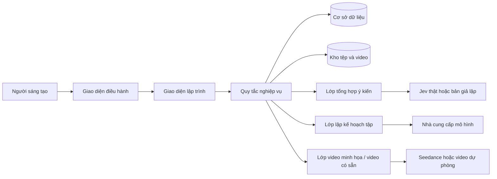
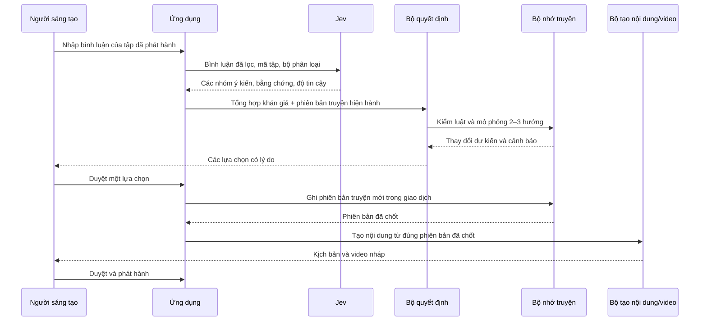

# Kiến trúc hệ thống Living Drama

Trạng thái: kiến trúc bản trình diễn tại máy; các mở rộng được nêu riêng
Nguồn yêu cầu: `Living_Drama_PRD_Vi.docx`, phiên bản 1.0 (tệp nguồn riêng, không đưa lên Git)
Phạm vi: một câu chuyện, ba tập, một người sáng tạo vận hành

## 1. Mục tiêu thiết kế

Living Drama giúp người sáng tạo làm tập tiếp theo dựa trên phản hồi khán giả, trong khi câu chuyện vẫn liền mạch. Hệ thống phải trả lời được ba câu hỏi cho mọi tập đã phát hành: khán giả đã phản hồi gì, vì sao chọn diễn biến này, và thế giới truyện đã thay đổi ra sao.

Đối với bản trình diễn, độ tin cậy của vòng lặp quan trọng hơn khả năng phục vụ nhiều người dùng. Hệ thống cần chạy được bằng bình luận mẫu, một Jev giả lập đúng hợp đồng dữ liệu và video chuẩn bị sẵn nếu nhà cung cấp chưa sẵn sàng. Những chế độ này phải được hiển thị rõ trong giao diện và lịch sử xử lý.

## 2. Những quyết định kiến trúc đề xuất

| Quyết định | Lý do | Giới hạn |
| --- | --- | --- |
| Một ứng dụng Node.js gồm giao diện tĩnh, điểm gọi HTTP và các mô-đun nghiệp vụ tách biệt | Chạy ngay trên máy với Node.js 24, không cần tải thư viện bổ sung | Cần bổ sung xác thực và cấu hình triển khai trước khi đưa lên mạng công cộng |
| Mã giao diện JavaScript thuần và máy chủ HTTP trong cùng kho mã | Phù hợp bản chạy thử một người, giúp kiểm vòng lặp trước khi chọn nền tảng giao diện lâu dài | Chưa có tiến trình xử lý tác vụ nền cho Jev/LLM/Seedance thật |
| SQLite tích hợp trong Node.js cho dữ liệu và giao dịch chốt phiên bản | Lưu lại kết quả giữa các lần chạy; chốt truyện và lịch sử trong cùng giao dịch | Khi nhiều người cùng dùng hoặc tải lớn, cần đánh giá chuyển sang PostgreSQL |
| Kho tệp cục bộ cho demo, có lớp giao tiếp để đổi sang kho tệp đối tượng | Cho phép phát video chuẩn bị sẵn hoặc video do nhà cung cấp trả về | Đường dẫn tệp không được xem là hợp đồng nghiệp vụ |
| Jev, LLM và Seedance đi qua ba lớp kết nối riêng | Không gắn mô hình truyện với cấu trúc yêu cầu của nhà cung cấp | Hợp đồng thực tế cần xác nhận trong giai đoạn khám phá |
| Một người sáng tạo được cấu hình trước; phân quyền đơn giản | Đúng phạm vi PRD | Chưa có tài khoản cộng đồng hay cộng tác nhiều người |

Đây là lựa chọn kỹ thuật cho bản chạy thử, chưa phải ràng buộc của PRD. Thiết kế ban đầu đã cân nhắc Next.js và PostgreSQL; mã hiện dùng Node.js và SQLite để chạy được ngay trên máy. Nếu mở rộng, việc chuyển đổi cần giữ nguyên các quy tắc nghiệp vụ và hợp đồng dữ liệu.

## 3. Sơ đồ tổng thể



`CORE` gồm các mô-đun sau; mỗi mô-đun chỉ đọc và ghi qua giao diện lưu trữ của mình:

| Mô-đun | Trách nhiệm |
| --- | --- |
| Quản lý câu chuyện | Hồ sơ câu chuyện, nhân vật, bí mật, luật cứng, hướng phát triển, hồ sơ hình ảnh |
| Bộ nhớ truyện | Các phiên bản sự thật đã chốt, so sánh thay đổi, nhánh thử nghiệm, kiểm tra xung đột phiên bản |
| Tiếp nhận phản hồi | Nhập dữ liệu mẫu hoặc CSV, kiểm tra trường, ẩn thông tin cá nhân, gộp bình luận trùng |
| Hiểu khán giả | Tạo bản tổng hợp có nhóm ý kiến, bằng chứng, độ tin cậy và chất lượng mẫu |
| Quyết định diễn biến | Tạo 2–3 lựa chọn, chấm điểm hỗ trợ, kiểm luật cứng, mô phỏng thay đổi |
| Sản xuất tập | Tạo tóm tắt, dàn ý, kịch bản, kế hoạch cảnh quay và yêu cầu video |
| Duyệt và phát hành | Chặn các thao tác khi thiếu duyệt hoặc dùng phiên bản truyện cũ |
| Lịch sử xử lý | Lưu người thực hiện, thời gian, dữ liệu đầu vào, lý do, thay đổi và kết quả |

## 4. Luồng xử lý chính

### 4.1 Tạo và phát hành tập đầu

1. Người sáng tạo nhập hồ sơ câu chuyện. Bộ kiểm tra yêu cầu ít nhất hai nhân vật, một bí mật có mức hiển thị, luật cứng và hướng phát triển.
2. Hệ thống tạo phiên bản thế giới truyện `v0`. Mỗi phiên bản là bản chụp chỉ đọc sau khi đã ghi.
3. Người sáng tạo lập kế hoạch tập 1 trên `v0`. Mô hình viết chỉ nhận phần thông tin phù hợp với từng loại đầu ra; bí mật chưa được phép tiết lộ không được đưa vào chỉ dẫn dành cho hình ảnh/video.
4. Người sáng tạo duyệt kịch bản, duyệt video, rồi bấm phát hành. Hệ thống ghi liên kết từ tập đến kế hoạch, phiên bản truyện và lịch sử duyệt.

### 4.2 Từ bình luận đến tập tiếp theo



Quyết định đã duyệt có thể tạo phiên bản truyện cho tập đang sản xuất trước khi tập đó phát hành, đúng luồng trong PRD. Vì vậy cần phân biệt **sự thật sáng tác đã chốt** với **sự kiện đã được khán giả xem**. Phiên bản mới được phép dùng để viết tập đang sản xuất, nhưng chưa được dùng làm điểm xuất phát cho một tập khác cho đến khi tập hiện tại phát hành. Nếu hủy tập, không xóa phiên bản; người sáng tạo cần một quyết định điều chỉnh có ghi lịch sử. Quy tắc này tránh nhầm một diễn biến dự kiến với diễn biến đã lên sóng.

### 4.3 Quy tắc giao dịch khi chốt diễn biến

Trong một giao dịch cơ sở dữ liệu:

1. Khóa bản ghi `show` của câu chuyện và so `base_state_version` với phiên bản hiện hành.
2. Kiểm trạng thái quyết định là `approved`, không có luật cứng nào `fail`, và các bằng chứng tham chiếu còn tồn tại.
3. Áp dụng các phép thay đổi `set`, `append`, `resolve`, `reveal` lên bản sao trạng thái.
4. Chạy kiểm tra tính nhất quán của bản sao; tăng phiên bản và ghi bản chụp bất biến.
5. Ghi quyết định là `committed`, cùng người duyệt, lý do, thay đổi và bản ghi lịch sử.

Nếu phiên bản gốc đã thay đổi, trả `409 STATE_VERSION_CONFLICT`; không tự ghép nhánh. Yêu cầu chốt dùng khóa chống lặp để gửi lại không tạo thêm phiên bản.

## 5. Cơ chế giữ mạch truyện

Mỗi câu chuyện cần một **xương sống** do người sáng tạo định nghĩa: tiền đề, bí mật thật, động cơ nhân vật, các mốc quan trọng, phần kết dự kiến và những điều không được phá. Khán giả được tác động vào những khoảng lựa chọn đã cho phép, chẳng hạn hành động của nhân vật, nhịp tiết lộ, mức căng thẳng hoặc sắc thái cảnh.

Các phép kiểm tra trước khi duyệt một lựa chọn hoặc kịch bản:

| Lớp kiểm tra | Ví dụ |
| --- | --- |
| Sự thật | Nhân vật không thể dùng vật chưa từng có; không thể biết điều chưa được tiết lộ cho mình |
| Bí mật | Danh tính cô gái vẫn `hidden` thì lời thoại và hình ảnh không được tiết lộ |
| Động cơ | Hành động mới phải có lý do phù hợp mục tiêu và trạng thái cảm xúc |
| Tuyến truyện | Câu hỏi đang mở có người chịu trách nhiệm và thời điểm dự kiến giải quyết |
| Nhịp kể | Một tập 30–45 giây có mục tiêu, thay đổi và điểm dừng rõ ràng |
| Tính liên tục sản xuất | Trang phục, thời gian, địa điểm, đạo cụ khớp cảnh trước và sau |

Kiểm tra tự động có thể phát hiện quy tắc cấu trúc; các đánh giá tinh tế về động cơ, cảm xúc và nhịp kể cần người sáng tạo duyệt. Điểm chấm của hệ thống là thông tin tham khảo, không tự quyết định nội dung.

## 6. Cơ chế giữ hình ảnh nhất quán

Hồ sơ hình ảnh của câu chuyện lưu các mục có mã ổn định và phiên bản:

- Nhân vật: ảnh tham chiếu được duyệt, mô tả ngoại hình, giọng nói, trang phục, phụ kiện và những dấu hiệu dễ nhận biết.
- Bối cảnh: ảnh tham chiếu, sơ đồ không gian, màu sắc, thời điểm trong ngày, quy tắc ánh sáng.
- Đạo cụ: hình dạng, màu, chủ sở hữu, trạng thái và vị trí sau mỗi cảnh.
- Phong cách quay: tỷ lệ hình, bảng màu, cỡ cảnh, chuyển động máy và nhịp dựng.

Mỗi cảnh dùng một `shot_plan` đã khóa phiên bản, ghi mã nhân vật, trang phục, địa điểm, đạo cụ và ảnh tham chiếu. Bộ kết nối video nhận một gói yêu cầu dựng từ các mã này; kết quả trả về phải gắn với đúng phiên bản gói yêu cầu. Người sáng tạo kiểm tra video theo danh sách lỗi: sai mặt, sai trang phục, sai vị trí đạo cụ, sai bối cảnh, lộ bí mật hoặc thay đổi hành động. Cảnh lỗi được tạo lại riêng hoặc thay bằng tư liệu dự phòng.

Tài liệu Seedance 2.0 trong `references/` xác nhận ảnh đầu cảnh, ảnh cuối cảnh, ảnh tham chiếu, tác vụ bất đồng bộ và giới hạn 4–15 giây mỗi cảnh. Bản chạy hiện tại tạo ảnh nhân vật/khung đầu bằng Seedream, đưa ảnh đầu cảnh cho Seedance, yêu cầu trả khung cuối để gợi ý cho cảnh sau. Mỗi tập 37 giây cần ba tác vụ cảnh. Liên kết Seedream có thời hạn được ưu tiên khi còn hiệu lực; ứng dụng lưu bản ảnh tại máy để có thể gửi dữ liệu ảnh trực tiếp sau khi URL hết hạn. Cần kiểm chứng chất lượng đồng nhất nhân vật bằng tài khoản thật trước khi coi đây là bảo đảm hình ảnh.

## 7. Lưu trữ và độ tin cậy

Các bảng hiện có: `shows`, `world_states`, `episodes`, `comments`, `audience_minds`, `decisions`, `audit_events`. Hợp đồng dữ liệu trong đặc tả định hướng các bảng hoặc cột cần thêm khi tích hợp dịch vụ thật: phiên bản hồ sơ hình ảnh, tài sản tham chiếu, nhánh thử và tác vụ video.

- `world_states` chỉ được thêm mới, không sửa hoặc xóa bằng giao diện sản phẩm.
- `shows.current_version` và `world_states.version` được cập nhật trong cùng giao dịch.
- Khi bật tích hợp nhà cung cấp thật, cần thêm hàng tác vụ bền và cơ chế thử lại trước khi gọi Jev/LLM/Seedance; bản hiện tại chạy mô phỏng tại máy.
- Tập và quyết định tham chiếu mã bản tổng hợp khán giả, phiên bản truyện, phiên bản chỉ dẫn và tài sản hình ảnh. Không chỉ lưu văn bản diễn giải.
- Video nằm trong kho tệp; cơ sở dữ liệu lưu mã tệp, đường dẫn nội bộ, mã băm nếu có, nguồn tạo và quyền sử dụng.
- Mọi yêu cầu mang `correlation_id` để lần theo chuỗi nhập phản hồi → tổng hợp → quyết định → kịch bản → video.

## 8. An toàn dữ liệu và quyền truy cập

Trong bản demo, chỉ tài khoản người sáng tạo được gọi thao tác thay đổi. Bình luận nhập vào được gán `author_ref` đã băm; mẫu hiển thị phải được ẩn thông tin cá nhân. Bí mật truyện được gắn mức hiển thị và chỉ cấp cho tác vụ cần biết. Khóa truy cập nhà cung cấp lưu phía máy chủ, không đi vào trình duyệt, nhật ký hoặc tệp xuất.

Các trường hợp bình luận độc hại, dữ liệu kém chất lượng, hoặc kết quả mô hình không đúng cấu trúc được đánh dấu và chặn ở ranh giới Jev. Nội dung do LLM hoặc Seedance tạo phải qua kiểm tra cấu trúc và người sáng tạo duyệt trước khi phát hành.

## 9. Giao diện chính

`Tổng quan câu chuyện → Hộp thư phản hồi → Bức tranh ý kiến khán giả → Bảng lựa chọn diễn biến → Không gian làm tập → Tác vụ video → Duyệt phát hành`. Từ mọi tập đã phát hành, người dùng mở được phiên bản truyện, quyết định và bằng chứng liên quan. Màn hình so sánh phiên bản cho thấy các sự thật nào thay đổi; màn hình thử nhánh không làm đổi mạch chính.

## 10. Những điểm phải xác nhận trong giai đoạn khám phá

1. Hợp đồng Jev thật: vị trí kiểm cấu trúc đầu ra, giới hạn dữ liệu, xác thực và mã lỗi.
2. Hợp đồng Seedance: xác thực, ảnh tham chiếu, gọi tác vụ, theo dõi trạng thái, nhận video và lưu trữ.
3. Nhà cung cấp LLM, giới hạn ngữ cảnh, giá, phiên bản chỉ dẫn và cách kiểm đầu ra.
4. Bộ nhóm ý kiến cố định cho câu chuyện mẫu và bộ dữ liệu bình luận đã kiểm tra.
5. Ai là người duyệt script, video và phát hành; một người có thể thực hiện cả ba bước trong demo hay không.
6. Nguồn video demo: tạo trực tiếp, chuẩn bị trước hoặc kết hợp.

Các câu hỏi này không chặn chế độ giả lập đúng hợp đồng. Chúng chặn việc tuyên bố đã tích hợp nhà cung cấp thật.

## 11. Những gì chưa làm trong MVP

Không có kết nối mạng xã hội thực, đăng bài tự động, ứng dụng điện thoại riêng, nhiều tài khoản cùng biên tập, thanh toán, phân tích tiếp thị nâng cao, tìm kiếm toàn bộ kho video hoặc xuất bản tự động không cần người duyệt.

## 12. Cấu trúc kho mã đề xuất

```text
src/domain.mjs          # Phân nhóm phản hồi, tạo lựa chọn, chốt thay đổi, lập kế hoạch tập
src/store.mjs           # Bảng SQLite và dữ liệu mẫu
src/server.mjs          # Điểm gọi HTTP và cổng duyệt
public/index.html       # Khung giao diện
public/app.js           # Màn hình và thao tác
public/styles.css       # Trình bày, tương thích màn hình nhỏ
tests/                  # Kiểm quy tắc và luồng HTTP
docs/                   # Kiến trúc, đặc tả và hợp đồng dữ liệu
data/                   # Dữ liệu chạy tại máy; không đưa vào kho mã
```

Không đặt quy tắc nghiệp vụ trong mã màn hình hay mã kết nối nhà cung cấp. Dữ liệu demo dùng cùng giao diện nhập và cùng bộ kiểm cấu trúc với dữ liệu thật.

## 13. Kế hoạch kiểm chứng

- Kiểm tra quy tắc: nhánh thử nghiệm không đổi mạch chính; luật cứng `fail` chặn duyệt; bí mật `hidden` không rò vào đầu ra công khai; trạng thái cũ không được phát hành.
- Kiểm tra giao dịch: hai yêu cầu chốt cùng lúc chỉ tạo một phiên bản hợp lệ; gửi lại cùng khóa chống lặp không nhân đôi; lỗi nhà cung cấp không làm mất bản chụp truyện.
- Kiểm tra hợp đồng: hiện có JSON Schema làm cơ sở; cần nối bộ kiểm cấu trúc vào điểm gọi nhà cung cấp trước khi bật Jev thật.
- Kiểm tra luồng: các phép kiểm hiện có đi từ bình luận đến kế hoạch tập 2; cần mở rộng đến video, phát hành và AC-01 đến AC-11 khi có tài sản demo cuối.
- Kiểm tra hình ảnh bằng người: so video nháp với hồ sơ hình ảnh về gương mặt, trang phục, bối cảnh, đạo cụ và lỗi tiết lộ bí mật. Chưa có cơ sở để coi bước này là tự động hoàn toàn.
